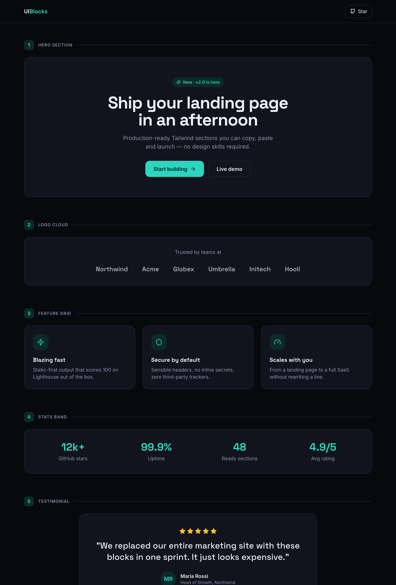

# Tailwind UI Blocks — Free Copy-Paste Marketing Sections

A set of polished, copy-paste **Tailwind CSS marketing sections** for **Next.js 14** — hero, logo cloud, feature grid, stats band, testimonial, FAQ accordion and CTA. Theme-aware, responsive, zero dependencies beyond lucide icons.




> ⭐ **Star the repo** if it saves you time.

## 🧱 Blocks included

1. **Hero** — centered headline, badge, dual CTA
2. **Logo cloud** — "trusted by" strip
3. **Feature grid** — 3-up icon features
4. **Stats band** — 4 key metrics
5. **Testimonial** — star rating + quote + author
6. **FAQ** — accessible accordion (one-open)
7. **CTA** — gradient call-to-action with trust badges

All theme-aware (light/dark) via CSS variables — change your brand color in one place.

## 🚀 Quick Start

```bash
git clone https://github.com/omer-poyraz/tailwind-ui-blocks.git
cd tailwind-ui-blocks && npm install && npm run dev
```

Every block is a `<section>` in [`app/page.tsx`](app/page.tsx). **Copy the section you want** into your page — no config, no imports to untangle.

---

## ⭐ Need the dashboard too?

These marketing blocks pair with a full set of **production-ready Next.js admin panels**:

### 👉 [**Admin Templates Bundle — 6 dashboards for $99**](https://omerpoyraz.gumroad.com/l/nextjs-admin-bundle)  ·  [free admin starter](https://github.com/omer-poyraz/nextjs-admin-dashboard-starter)

E-commerce · CRM · SaaS metrics · Blog/CMS · Project manager · Help desk.

---

## 📄 License

MIT © [Ömer Poyraz](https://omerpoyraz.gumroad.com). Free for personal and commercial use.

## 🔖 Keywords

`tailwind blocks` · `tailwind sections` · `landing page sections` · `tailwind ui` · `marketing sections` · `hero section` · `feature grid` · `faq accordion` · `nextjs tailwind`
